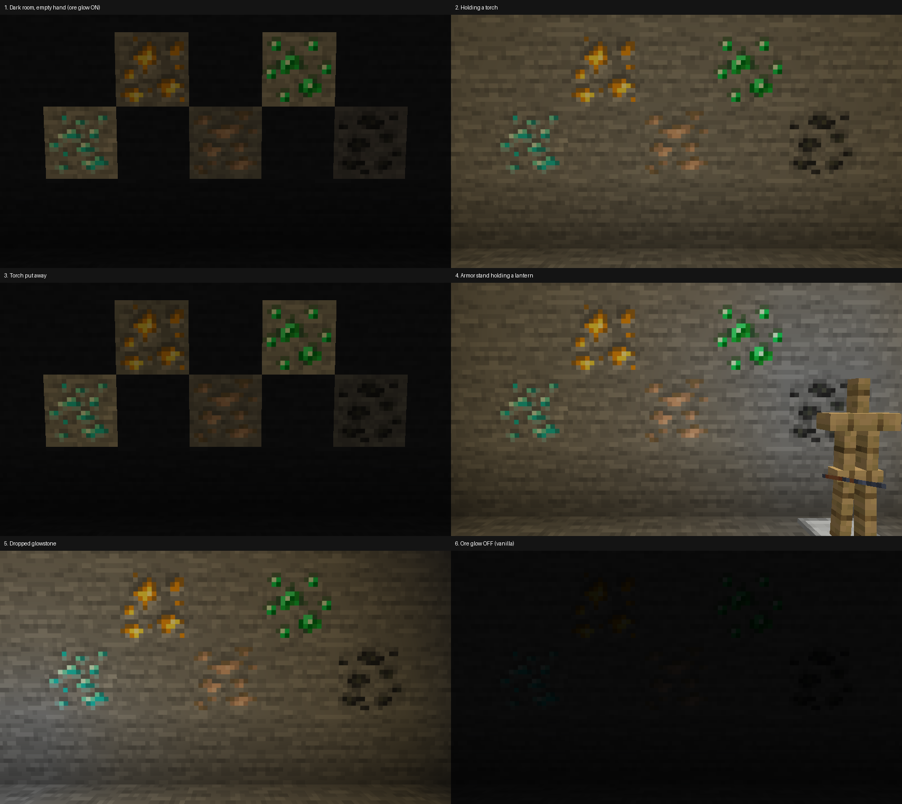
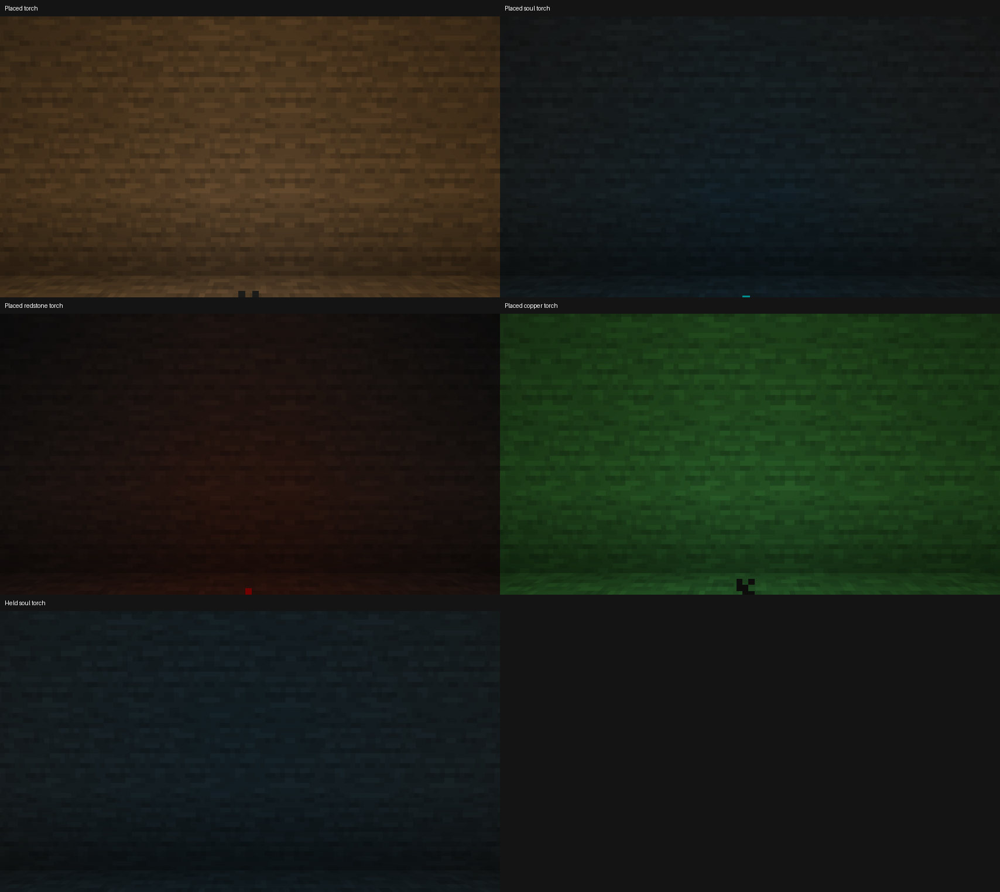

# Visual Mod

A small, **client-side only** Fabric mod for Minecraft **26.3** that adds dynamic lights and colored torch light without costing performance.
It works on any server (vanilla, Paper, other modded servers), because nothing is sent to or needed on the server.



## Features

### Dynamic lights
Light sources light up their surroundings while they move:

- torches, lanterns, glowstone, sea lanterns, jack o'lanterns, … held by you or other players (main hand and off hand)
- the same items held or worn by mobs and armor stands
- dropped light-source items lying on the ground
- burning entities
- extra items: lava bucket, blaze rod and powder, glow berries, glow ink sac, nether star, …

Block items use their block's own light level automatically, which includes blocks from other mods.
Torches, campfires and similar fire items go out when the holder's head is underwater.
Mobs and items near a light source are lit by it too.

*Performance:*
- Light sources are picked up while entities tick, so there's no extra scan of the world.
- Only entities within 48 blocks of the camera count, and at most 24 sources at once (the closest ones).
- Terrain is re-meshed only when a source moves into a **different block** or changes brightness, and only the ≤ 8 chunk sections its light can reach (7.5 block radius).
- That re-meshing runs on vanilla's background chunk-builder threads.
- With no light sources nearby, the hook costs a single field read.

### Colored light
Torch families light their surroundings in their own color, whether placed or held:

| Light source | Color |
| --- | --- |
| Torch, lantern, campfire | warm orange |
| Soul torch, soul lantern, soul campfire | blue |
| Redstone torch | red |
| Copper torch, copper lanterns (all oxidation stages) | green |

Brightness stays exactly vanilla's; only the hue changes. The tint is strongest in caves and weaker where there's sky light. Mobs and players aren't tinted.



*Performance:*
- The tint is applied while chunk meshes are built, so it costs nothing per frame.
- Placed torches are tracked in a small per-chunk-section index. On chunk load, sections without any torch are skipped with a palette check.

## Configuration

`config/visualmod.properties` is created the first time you launch the game. All features can be turned off and tuned:

| Key | Default | Meaning |
| --- | --- | --- |
| `dynamicLights` | `true` | Enable dynamic lights |
| `heldItemLights` | `true` | Items held by players |
| `mobItemLights` | `true` | Items held or worn by mobs and armor stands |
| `droppedItemLights` | `true` | Dropped item entities |
| `burningEntityLights` | `true` | Burning entities |
| `waterSensitive` | `true` | Torches etc. go out underwater |
| `maxDistance` | `48` | Max distance (blocks) from the camera for light sources |
| `maxSources` | `24` | Max simultaneous light sources |
| `coloredLights` | `true` | Enable colored light |
| `coloredLightStrength` | `80` | Tint strength in percent (0–100) |
| `item.<item id>` | see file | Light level for non-block items, e.g. `item.minecraft\:blaze_rod=10` |

In `.properties` files, the `:` in ids must be written as `\:`. The generated file already does this.
Restart the game after changing settings. Ore settings left over from older versions are ignored and removed.

## Installing

1. Install [Fabric Loader](https://fabricmc.net/use/) for Minecraft 26.3 (Java 25 is required).
2. Put [Fabric API](https://modrinth.com/mod/fabric-api), [Sodium](https://modrinth.com/mod/sodium) (0.9.3-beta.5 or newer for 26.3) and `visual-mod-<version>.jar` into your `mods` folder. Sodium is required.

## Building

```sh
./gradlew build
```

The jar ends up in `build/libs/`. Building needs JDK 25.
Every push also builds the jar on GitHub Actions (see `.github/workflows/build.yml`).

## Testing

```sh
./gradlew runClientGameTest
```

This starts the real game, builds a sealed dark room, and checks every light source:
it takes screenshots and compares their brightness.
The checks are: the room is dark with nothing held, holding a torch, putting it away, an armor stand holding a lantern, dropped glowstone, the color of each placed torch type, and a held soul torch.
It also forces every mixin to apply, so a broken mixin target fails the test.
Screenshots are saved to `build/run/clientGameTest/screenshots/`.

To run it without a monitor or GPU (Linux), you need Xvfb plus Mesa's software OpenGL/Vulkan drivers:

```sh
LIBGL_ALWAYS_SOFTWARE=1 SDL_VIDEO_FORCE_EGL=1 xvfb-run -a -s "-screen 0 1920x1080x24" ./gradlew runClientGameTest
```

## Compatibility notes

- Requires Sodium; dynamic and colored light are tested with it. Colored light hooks into Sodium's chunk mesher (and Fabric's Indigo renderer, used when Sodium isn't present).
- Colored light can bleed slightly through thin walls, and water isn't tinted.
- Don't use it together with another dynamic-lights mod (LambDynamicLights, Ryoamic Lights, …). Pick one, or set `dynamicLights=false` here.
